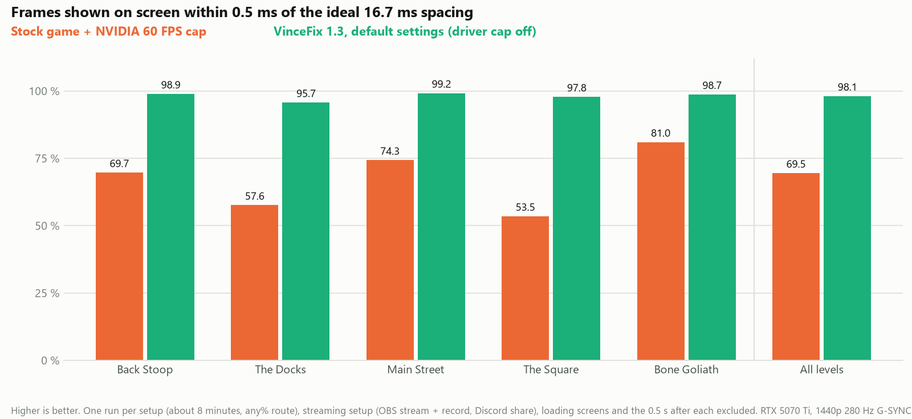

# VinceFix

Smoother frame pacing for **Voodoo Vince Remastered** on PC. A small drop-in DLL that:

- **Unpins the game's threads**, so Discord, OBS or drivers no longer cause late frames.
- **Removes an audio stall** that blocked the main thread dozens of times a minute.
- **Renders at native resolution**, ignoring Windows display scaling.
- **Paces frames evenly** (new in 1.3) with a built-in 60 FPS cap and a short frame hold. Works on any GPU.

It changes no game files and removes cleanly.

<picture>
  <source media="(prefers-color-scheme: dark)" srcset="docs/anypct-shown-dark.png">
  
</picture>

## Results

Measured on one PC (Ryzen 7 5800X3D, RTX 5070 Ti, 1440p 280 Hz G-SYNC) while streaming with OBS and Discord. Your results may differ. AMD and Intel GPUs are untested.

| Frames evenly spaced (±0.5 ms) | Stock | **VinceFix 1.3** |
|---|---:|---:|
| Partial any% route | 69.5 % | **98.1 %** |
| Frames over 21 ms | 36 | **8** |

## Install

1. Close the game.
2. Download `VinceFix-1.3.zip` from [Releases](../../releases).
3. Copy `X3DAudio1_7.dll` and `VinceFix.ini` into the game folder, next to `Vince.exe`. In Steam: *Manage → Browse local files*.
4. Turn off any other frame cap for the game (NVIDIA Max Frame Rate, RTSS, etc.). Recommended, not required.
5. Start the game. A `VinceFix.log` appears in the same folder.

**Uninstall:** delete `X3DAudio1_7.dll`, `VinceFix.ini` and `VinceFix.log`.

**Requirements:** Steam version 1.14.2.0, Windows 10 (1703+), and the DirectX June 2010 runtime the game already needs.

## Settings

Edit `VinceFix.ini` with Notepad and restart the game. The defaults are recommended:

```ini
FrameCap=60
PresentHold=auto
HoldFlush=auto
LiveReload=0
```

| Setting | What it does |
|---|---|
| `FrameCap` | Caps the game at this FPS. `0` = off. |
| `PresentHold` | Briefly holds each frame so they appear evenly spaced. `auto`, `0` (off), or `1`–`12` ms. Adds about 1 ms of input latency. |
| `HoldFlush` | Sends work to the GPU early during the hold. `auto`, `1` or `0`. |
| `LiveReload` | `1` applies ini changes without restarting. |

**Displays:** on 60 Hz displays the cap and hold turn themselves off. On a fixed-refresh display above 60 Hz without G-SYNC/FreeSync (e.g. 144 Hz), set `FrameCap=0` and `PresentHold=0`, or switch the display to 60 Hz.

## Checking that it works

Open `VinceFix.log` in the game folder. You should see lines like `SetThreadAffinityMask ignored`, `effective awareness 2` and `frame cap: 60 FPS`. The log contains no personal information, so you can post it when asking for help.

## Good to know

- **Speedrunners:** the cap and hold change frame timing. Check your leaderboard's rules first, or set `FrameCap=0` and `PresentHold=0`.
- **Safety:** VinceFix uses no network, registry or admin rights, and only patches the game in memory. The build is reproducible; see [BUILDING.md](BUILDING.md).
- **AMD/Intel:** the hold and flush are untested there. If anything feels worse, set `PresentHold=0` and open an issue with your log.
- **Limits:** it can't fix stalls caused by other programs, the driver, or the game's own loading hitches.

## Build from source

Requires [LLVM](https://github.com/llvm/llvm-project/releases). See [BUILDING.md](BUILDING.md).

```powershell
pwsh -File build.ps1 -Test
```

## License

MIT, see [LICENSE](LICENSE). Not affiliated with the game's developer or publisher.
