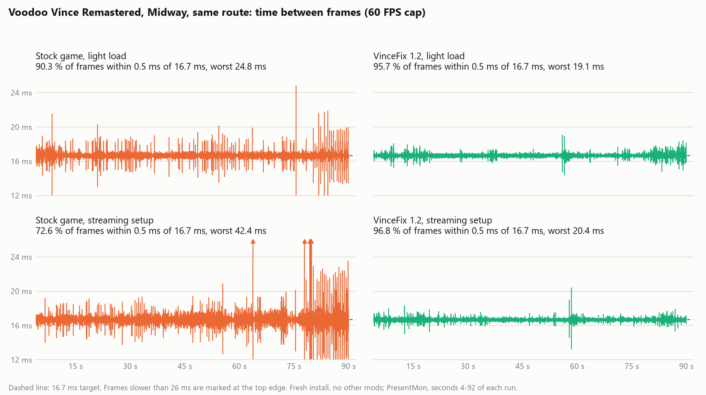

# VinceFix

Smoother frame pacing for **Voodoo Vince Remastered** on PC. VinceFix is a small drop-in DLL that:

- **unpins the game's threads.** The game locks its busy threads to CPUs 0 to 4, so a frame comes out late whenever anything else (Discord, OBS, a driver) runs on one of those CPUs, even while the rest of the processor sits idle.
- **removes an audio stall.** Dozens of times a minute the game asks Windows about your audio device, and each question blocks the main thread for about 1.8 ms. VinceFix answers from memory instead.
- **renders at native resolution.** The game ignores Windows display scaling. At 125 % scaling it renders 2048×1152 and Windows stretches it to 2560×1440; with VinceFix it renders 2560×1440 directly.
- **new in 1.3: paces frames evenly.** The game's frames arrive at uneven intervals even at a steady 60 FPS. VinceFix 1.3 caps the game at 60 FPS itself (**FrameCap**) and holds each finished frame for a moment so frames reach the screen evenly spaced (**PresentHold**, **HoldFlush**). It works on any GPU and needs no driver or RTSS frame cap.

It changes no game files, and it removes cleanly. [What it does and doesn't do on your PC](#what-vincefix-does-and-doesnt-do) is spelled out below.

<picture>
  <source media="(prefers-color-scheme: dark)" srcset="docs/anypct-shown-dark.png">
  
</picture>

## Results

All numbers come from **one PC and one run per setup**: Ryzen 7 5800X3D, RTX 5070 Ti, Windows 11, 2560×1440 at 280 Hz with G-SYNC. They show what happened on that PC, not what will happen on yours. **AMD and Intel GPUs are untested**; reports are welcome (see [AMD and Intel](#amd-and-intel)).

"Shown within ±0.5 ms" means frames that reached the screen 16.2 to 17.2 ms after the previous one, which is what you see as smooth motion at 60 FPS. Measured with PresentMon 2.3.1.

### Whole any% route, streaming setup (new in 1.3)

The route: menu, Back Stoop, The Docks, Main Street, The Square, Bone Goliath, about 8 minutes, with the first 4 seconds, the loading screens and the 0.5 seconds after each one left out. The load is the heaviest one: OBS streaming and recording plus a Discord screen share.

- **Stock:** the unmodified game with the NVIDIA Max Frame Rate cap at 60.
- **VinceFix 1.3:** the shipped default settings (FrameCap=60, PresentHold=auto, HoldFlush=auto), NVIDIA cap off.

| Frames shown within ±0.5 ms of 16.7 ms | Stock | **VinceFix 1.3** |
|---|---:|---:|
| Back Stoop | 69.7 % | **98.9 %** |
| The Docks | 57.6 % | **95.7 %** |
| Main Street | 74.3 % | **99.2 %** |
| The Square | 53.5 % | **97.8 %** |
| Bone Goliath | 81.0 % | **98.7 %** |
| **All levels** | **69.5 %** | **98.1 %** |

| Whole route | Stock | **VinceFix 1.3** |
|---|---:|---:|
| Frames sent within ±0.5 ms | 77.0 % | **99.7 %** |
| Frames shown within ±1 ms | 89.8 % | **99.5 %** |
| Time from Present to screen, typical (p50) | 1.32 ms | **0.99 ms** |
| Time from Present to screen, slowest 1 % (p99) | 3.29 ms | **1.85 ms** |
| Frames over 21 ms | 36 | **8** |

Frames over 21 ms fell from 36 to 8. The 8 that remain are the game's own level-transition hitches, nearly all a stall about 1 second before a loading screen. Each loading screen and the 0.5 seconds after it (the game's load-edge frames, 54 to 139 ms) are left out of every number in this table. The stalls in the middle of levels (5 long CPU stalls and 26 smaller work spikes in the stock run, all but one) are gone. The hold and the cap did not remove them; they only even out frame spacing. The cause is probably the thread unpinning (stock pins the render thread to one CPU), but that is not confirmed, so credit goes to VinceFix as a whole.

VinceFix's hold adds a little input latency that "Present to screen" doesn't count (see PresentHold below); in these runs auto's hold ranged from 1.8 ms to 6.7 ms.

### Back Stoop on its own, light load

No streaming, no recording; Discord open without a screen share. Stock (NVIDIA cap 60) against VinceFix with FrameCap=60, a fixed PresentHold=4 and HoldFlush=auto (an earlier setting than the shipped `auto`), 71 seconds of the level:

| | Stock | **VinceFix** |
|---|---:|---:|
| Frames shown within ±0.5 ms | 83.3 % | **99.4 %** |
| Frames sent within ±0.5 ms | 92.3 % | **99.9 %** |
| Present to screen, p50 / p99 | 1.32 / 3.71 ms | **1.11 / 1.29 ms** |
| Frames over 21 ms | 4 | **2** |

Those frames over 21 ms are stalls at the loading screens (115 to 141 ms in both runs).

### The 1.2 fixes alone (unchanged)

Same route through the Midway level, about 90 seconds per run, fresh install with no other mods, NVIDIA 60 FPS cap, Windows scaling 125 %. *Light load:* no streaming, recording or screen share. *Streaming:* OBS streaming and recording plus a Discord screen share. Seconds 4 to 92 of each run.

| | Stock, light load | **VinceFix 1.2, light load** | Stock, streaming | **VinceFix 1.2, streaming** |
|---|---:|---:|---:|---:|
| Frames within 0.5 ms of 16.7 ms | 90.3 % | **95.7 %** | 72.6 % | **96.8 %** |
| On-screen intervals within 0.5 ms | 77.0 % | **92.1 %** | 62.6 % | **93.7 %** |
| Frame-time spread (standard deviation) | 0.545 ms | **0.235 ms** | 1.074 ms | **0.222 ms** |
| Worst frame | 24.8 ms | **19.1 ms** | 42.4 ms | **20.4 ms** |
| Frames over 21 ms | 5 | **0** | 30 | **0** |

<picture>
  <source media="(prefers-color-scheme: dark)" srcset="docs/frame-time-dark.png">
  
</picture>

## Install

1. Close the game.
2. Download `VinceFix-1.3.zip` from the [Releases](../../releases) page and put `X3DAudio1_7.dll` and `VinceFix.ini` from it in the game folder, next to `Vince.exe`. With a default Steam install that is
   `C:\Program Files (x86)\Steam\steamapps\common\Voodoo Vince Remastered`.
   In Steam you can find it with *Manage → Browse local files*.
3. **Recommended: turn off any other frame cap for the game**: the NVIDIA *Max Frame Rate* setting for `Vince.exe`, an AMD or Intel driver limiter, or an RTSS limit. VinceFix works either way: if another limiter is capping the game, VinceFix's own FrameCap steps aside by itself (and comes back when that limiter stops). But the best result measured is with VinceFix's own cap, so turning the other one off is still recommended.
4. Start the game. A `VinceFix.log` appears in the same folder. [Read it](#checking-that-it-works) to see what is active.
5. If you had ticked Windows' high-DPI override for `Vince.exe` (*Properties → Compatibility → Change high DPI settings*), you can untick it; VinceFix does the same job. The *System* and *System (Enhanced)* overrides block the resolution fix, and the log warns you if one is set.

**Remove it** by deleting `X3DAudio1_7.dll`, `VinceFix.ini` and `VinceFix.log` from the game folder. Steam's *Verify integrity of game files* doesn't remove it, because it isn't one of the game's files.

### Requirements and compatibility

- Tested with the Steam version 1.14.2.0 of Voodoo Vince Remastered.
- Windows 10 version 1703 or later for the resolution fix.
- The DirectX June 2010 runtime, which the game already needs. VinceFix forwards the game's 3D-audio calls to the real `X3DAudio1_7.dll` from that runtime. If that file is missing, VinceFix shows a message and closes the game rather than running without positional audio.
- Works alongside mods that replace `XINPUT9_1_0.dll` (such as a free-camera mod).

## Recommended setup: the shipped defaults

`VinceFix.ini` ships with the `auto` preset, which is the setup the results above used:

```ini
FrameCap=60
PresentHold=auto
HoldFlush=auto
LiveReload=0
```

With a driver or RTSS frame cap off, that is all you need (with one on, VinceFix still works: see FrameCap below). What to expect on different displays:

| Your display | What VinceFix does | What to do |
|---|---|---|
| 60 Hz (fixed or variable refresh) | Turns FrameCap, the hold and the flush off by itself: VSync already holds the game to 60 | Nothing |
| Variable refresh (G-SYNC, FreeSync, Adaptive-Sync) above 61 Hz | Everything runs | Nothing. Make sure 60 FPS is inside your display's variable-refresh range |
| Fixed refresh above 61 Hz, no variable refresh (for example 120 or 144 Hz with G-SYNC off) | Everything runs. A 60 FPS cap on a fixed 120/144 Hz display judders, like any 60 FPS cap does, because 60 doesn't divide evenly into 144 | Set `FrameCap=0` and `PresentHold=0` in `VinceFix.ini` (the game then runs at your refresh rate, as without VinceFix), or set the display to 60 Hz. The 1.2 fixes work in every case |

VinceFix checks the game's display when the game starts, and again when the game changes resolution (a new swap chain, checked every frame) or its window moves to another monitor (checked once a second); the log then says `display rules checked again`.

To change a setting, edit `VinceFix.ini` in the game folder with Notepad (keep its first line, which is a comment) and restart the game. With `LiveReload=1` you don't need to restart.

## The settings

All four are in `VinceFix.ini`, which has the same explanations as below.

### FrameCap

`FrameCap=60` is VinceFix's own frame-rate cap: the game starts its frames exactly 1/60 s apart. It is the same kind of cap as NVIDIA's *Max Frame Rate* (it spaces frame **starts**, not just frame ends) and works on any GPU. The game was made for 60 FPS and its physics behave best there; without a cap it runs at your monitor's refresh rate (280 FPS on a 280 Hz monitor). It turns itself off when the display's refresh rate is 61 Hz or less. `0` = off; any whole number from 20 to 500.

**With a driver or RTSS cap also on:** FrameCap steps aside by itself while another limiter is waiting inside the game's Present call, and comes back when that limiter stops (the log says so; HoldFlush=`auto` stops flushing while FrameCap is aside). So leaving the driver cap on is fine. Turning it off is still recommended: in the light-load test below, frames shown within ±0.5 ms were 98.1 % with FrameCap plus the flush against 97.0 % with the NVIDIA cap plus the hold, and the flush only helps when FrameCap is running.

### PresentHold

The game's work per frame varies a little (a bit more in a busy scene), and if each frame is shown the moment it is finished, the time between frames on the screen varies the same way. A **hold** waits a fixed moment after the frame started before showing it, so frames are spaced evenly, in return for a little input latency (measured below). It does not make the game run faster or remove stutter; it only evens out when frames appear. It is meant for variable-refresh displays together with a frame cap.

- `auto` (default): VinceFix measures how long the game's work takes and picks the hold itself. It raises the hold within about a second when frames get heavier, lowers it slowly, and turns itself off when no frame cap is running. In the any% run it ranged from 1.8 ms (light scenes) to 6.7 ms (a heavy stretch).
- `1` to `12`: a fixed hold in milliseconds (decimals allowed). Keep it at least 2 ms below the frame time (16.7 ms at 60 FPS).
- `0`: off.

On a display of 61 Hz or less the hold turns itself off: frames are shown on the display's refresh anyway, so it would only add latency.

**Latency.** PresentHold adds a little input latency, because each frame waits to be presented on time. On the author's PC, frame-start-to-screen went from 4.1 to 4.8 ms at the median with the auto preset (+0.75 ms), and from 3.6 to 5.2 ms with a fixed 4 ms hold (+1.6 ms). The slowest 1 % of frames were no slower (8.0 → 7.8 ms and 6.3 → 5.4 ms), because frames also reach the screen sooner after Present. One run each; from level to level the median change ranged from −0.3 to +1.4 ms. How this was estimated is in [How it works](#how-it-works).

### HoldFlush

Normally the game's graphics commands are only handed to the GPU when the frame is shown, so while VinceFix is holding the frame, the GPU sits idle and starts working only afterwards. A **Flush** tells Windows to hand the finished work to the GPU right away, so the GPU draws during the hold and the frame appears sooner and more evenly afterwards.

- `auto` (default): flush only when FrameCap is running.
- `1`: always flush before a hold (for experiments).
- `0`: never.

Why `auto` isn't "always": it depends on what the frame cap is. In a light-load comparison (one 30-second run each, a fixed 4 ms hold):

| Cap | Flush | Shown within ±0.5 ms | Frame starts within ±0.5 ms | Present to screen, p50 |
|---|---|---:|---:|---:|
| FrameCap 60 | off | 96.9 % | 98.1 % | 1.44 ms |
| FrameCap 60 | **on** | **98.1 %** | **99.4 %** | **1.09 ms** |
| NVIDIA cap | off | 97.0 % | 99.5 % | 1.58 ms |
| NVIDIA cap | on | 93.1 % | 97.6 % | 1.19 ms |

With FrameCap the flush improved everything. With NVIDIA's own cap it made the spacing worse: the driver's limiter seems to react to the earlier hand-over. So `auto` flushes only with FrameCap.

In `VinceFix.log`, the "present hold stats" line reports the flush time, and "ran past the hold": the number of frames where the game's work plus the Flush took longer than the hold, so the frame was shown at once, late. A few percent is normal (it was 2 % in the light-load run above).

### LiveReload

`LiveReload=1` makes VinceFix watch `VinceFix.ini` while the game runs. When you save a change to FrameCap, PresentHold or HoldFlush, it takes effect about a second later without restarting the game, and the log gets a `settings reloaded:` line saying what runs now. The `LiveReload` line itself is only read when the game starts. Default `0` (off).

## Checking that it works

Open `VinceFix.log` in the game folder. It is plain text. Each start of the game adds lines; the newest are at the bottom. You should see:

- `SetThreadAffinityMask ignored` lines (threads unpinned);
- `effective awareness 2` (native resolution);
- a line about XAudio2's `GetDeviceDetails` ending in `now cached`, then one `queried XAudio2` line;
- `frame cap: 60 FPS (frame starts 16.66 ms apart)` and `frame cap: the game's display runs at 280 Hz; cap on` (on a 60 Hz display: `... cap off`);
- `present hold: auto; patched Present call at +0x...`;
- `hold flush: on (HoldFlush=auto and FrameCap is on: ...)`.

If the game changes resolution or you move its window to another monitor, you may see `display: the game's swap chain changed; display rules checked again` or `display: the game window moved to another monitor; display rules checked again`, followed by the lines that changed (the 60 Hz rules are applied to the new display).

If you see `present hold: the game's display runs at 60 Hz; ... hold off`, VinceFix has turned the hold off for your display, as designed.

**If another frame limiter is on:** `frame cap: another frame limiter (a driver or RTSS cap, or VSync) is waiting inside Present, so VinceFix's cap steps aside; it comes back if that limiter stops` means VinceFix has stopped capping because a driver cap, RTSS or VSync already does. Later `frame cap: no other limiter is pacing the game any more; VinceFix's cap is back on` says it resumed. If you want VinceFix's own cap to run, turn the other limiter off. **Warning to act on:** `present hold: WARNING: ... no frame-rate cap is spacing frame starts` means the hold is limiting the frame rate by itself: set `FrameCap` or `PresentHold=0`.

Every 600 frames, then every 3,600, a `present hold stats:` line summarises the hold (how long it was, how many frames ran past it, the flush time, the time spent inside the game's Present call, and the latency figures described under [How it works](#how-it-works)).

### Lines about your PC (safe to share)

On the first frame the log also records which hardware VinceFix is running on, which helps when something doesn't work. For example:

```
gpu: "NVIDIA GeForce RTX 5070 Ti" (vendor 0x10DE NVIDIA, device 0x2C05), 3072 MB dedicated video memory (...), driver 32.0.16.1742
display: 280 Hz; swap chain: discard (blt model), 2 buffers of 2560x1440, windowed, flags 0x0; output on the same GPU as rendering
power: on AC power (no battery), battery saver off
os: Windows 10.0 build 26200 (Windows 11)
```

(`gpu:` the graphics card, its vendor, memory and driver; `display:` the refresh rate and how the game's window presents; `power:` mains or battery; `os:` the Windows build.) They contain no user name, PC name, or folder paths, so you can post the whole log when you ask for help.

## Speedrunners

FrameCap and PresentHold change the game's frame timing. If you submit runs to a leaderboard, check its rules or ask its moderators before using VinceFix in a run. (The 1.2 fixes, thread unpinning, DPI and the audio cache, are also in this DLL; set `FrameCap=0` and `PresentHold=0` to keep only those.)

## What VinceFix does and doesn't do

You are putting a DLL into a game's folder, so here is exactly what it does.

- **Files:** one DLL (`X3DAudio1_7.dll`), one settings file (`VinceFix.ini`) and one log (`VinceFix.log`), all in the game folder.
- **It writes only `VinceFix.log`**, next to the DLL; if that folder isn't writable, in your temp folder instead. It never writes the ini, or any game file.
- **No network, no registry, no new processes.** Its list of Windows functions has none of those (list below). It starts one background thread, and only when `LiveReload=1`, to watch the ini.
- **No administrator rights needed to play.** (Copying the DLL into a game folder under `Program Files` may ask for them, as copying anything there does.)
- **It patches only the game's code in memory, while the game runs.** Nothing on disk changes, and the patches vanish when the game closes. It redirects the game's `SetThreadAffinityMask` and `CoCreateInstance` imports, one XAudio2 function, and the game's single `Present` call. Everything it does is logged.
- **Remove it** by deleting the three files above. Steam's *Verify integrity of game files* doesn't remove it, because it isn't a game file.
- **Windows functions it uses:** kernel32.dll: CreateFileW, WriteFile, CloseHandle, GetPrivateProfileStringW, GetFileAttributesExW, GetModuleFileNameW, GetTempPathW, GetLocalTime, GetCurrentProcessId, GetLastError, GetThreadId, GetSystemDirectoryW, LoadLibraryW, GetProcAddress, ExitProcess, GetModuleHandleW, GetModuleHandleExW, VirtualProtect, FlushInstructionCache, GetCurrentProcess, DisableThreadLibraryCalls, GetProcessAffinityMask, AcquireSRWLockExclusive, ReleaseSRWLockExclusive, TryAcquireSRWLockShared, ReleaseSRWLockShared, QueryPerformanceCounter, QueryPerformanceFrequency, CreateWaitableTimerExW, SetWaitableTimer, WaitForSingleObject, CreateThread, FindFirstChangeNotificationW, FindNextChangeNotification, Sleep, GetSystemPowerStatus; user32.dll: MessageBoxW, MonitorFromWindow, GetMonitorInfoW, EnumDisplaySettingsW, SetProcessDPIAware. Looked up by name while the game runs (not in the import table): X3DAudioInitialize and X3DAudioCalculate (in the system copy of X3DAudio1_7.dll): the game's audio calls are forwarded to the real functions; SetProcessDpiAwarenessContext, GetThreadDpiAwarenessContext and GetAwarenessFromDpiAwarenessContext (in user32.dll): DPI fix: per-monitor awareness (Windows 10 1703 and later only, so looked up rather than imported); the two others report the awareness actually in effect to the log; SetThreadAffinityMask (in kernel32.dll): only its address, to find Vince.exe's import slot; never called; CoCreateInstance (in ole32.dll): the real function behind Vince.exe's patched import: every call is passed on to it unchanged. Each one is explained in imports-allowed.txt in the source.
- **Reproducible build:** anyone can build the DLL from the source here and compare. The release `X3DAudio1_7.dll` has SHA256 `1C0846C98700BD10F3623118B5FDCA1D517EC2360523F8277672D05FDBB568F3`; [BUILDING.md](BUILDING.md) says how to rebuild it and get the same hash.
- **Virus scan:** the author scans the release zip on VirusTotal before posting: https://www.virustotal.com/gui/file/be308fe0c5271598b30dbd4d1bd40d79fb1a1705be8414f324b98b490f0e4191. Result for 1.3: 1 of 66 engines flags it (Deep Instinct, a machine-learning scanner); all others, including Microsoft Defender, Kaspersky, ESET, Bitdefender, CrowdStrike and Malwarebytes, find nothing. DLLs that patch a game's code in memory often trip scanners that judge a file by how it looks, so a false positive like this is expected. The source is public and the build is reproducible: you can rebuild the DLL and compare its SHA256 yourself (see BUILDING.md).

## AMD and Intel

Everything above was measured on an NVIDIA card. Thread unpinning, the DPI fix, the audio cache and FrameCap don't depend on the GPU, so they should work everywhere, but the hold and flush have **not been tested on AMD or Intel**. If you try it, please send your `VinceFix.log` and, if you can, a capture. For that there is a small tester kit that records one run with and one without VinceFix and packs the results for you; I hand it out on Discord, so open an issue or message me and I'll send it. If anything feels worse, set `PresentHold=0` (or `FrameCap=0` too) and tell me.

## How it works

VinceFix is named `X3DAudio1_7.dll`, a DirectX audio library the game loads at startup. Windows finds the copy in the game folder first, so VinceFix loads before the game's own code runs. It then:

- **Unpins threads.** It points the game's own import of `kernel32!SetThreadAffinityMask` at a function that does nothing, so Windows schedules every game thread on whichever CPU is free. Only the game's import changes; the graphics driver, overlays and other code in the process keep the real function.
- **Sets per-monitor DPI awareness** before the game creates its window, the same mode as the *Override high DPI scaling behavior: Application* compatibility option.
- **Caches the audio device details.** Each time the game starts a sound that isn't placed in 3D space, it calls XAudio2 2.7's `IXAudio2::GetDeviceDetails(0)`, which lists every audio device through the Windows audio service: about 1.8 ms on the main thread, 40 to 70 times a minute in testing. VinceFix routes the game's `ole32!CoCreateInstance` import through itself. When the game creates its XAudio2 engine, VinceFix points the engine's `GetDeviceDetails` at a cache that the game's own startup call fills. XAudio2 2.7 and the game both fix the output device at startup and never switch, so the cached answer always describes the device the game is playing through. VinceFix also keeps `xaudio2_7.dll` loaded for the life of the game, so Windows can't unload it and drop the change.
- **Forwards 3D audio.** `X3DAudioInitialize` and `X3DAudioCalculate` jump straight to the real DLL in the Windows system folder.
- **Paces frames** (FrameCap, PresentHold, HoldFlush). The game has one `IDXGISwapChain::Present` call, which VinceFix finds by its code bytes and redirects to its own function. On the render thread that function (1) flushes the game's immediate D3D11 context if HoldFlush is on, (2) waits until the frame's start plus the hold (a waitable timer set 1.5 ms early, then a spin on the performance counter for the rest), (3) calls the real `Present`, and (4) with FrameCap, waits until the previous frame start plus 1/60 s. A frame that arrives after its hold point is presented at once. In auto mode it measures the 97th percentile of the game's work per 300 frames, adds 0.2 ms, and ramps the hold toward that (up 50 µs per frame, down 20 µs). On the first frame it reads the swap chain, the GPU and the display refresh rate (`GetDesc`, DXGI adapter, `EnumDisplaySettingsW`) for the log and for the 61 Hz rules.
- **How the latency was estimated.** PresentMon can't see FrameCap's wait: it counts it in the next frame's CPU time. So frame starts were rebuilt from PresentMon's times by replaying FrameCap's rule (a frame starts at the later of the previous Present's return and the previous start plus 1/60 s), and the replay was checked against runs with known answers (a fixed 4 ms hold came out at 4.00 ms within ±0.1 ms in 98.7 % of frames). Latency = frame start to the frame on screen. It assumes the game reads input near the start of its frame, before it calls Present; the *difference* between VinceFix and stock only needs the input to be read before Present, because the hold only delays what comes after that call. The two runs are different playthroughs, which is the biggest uncertainty.
- **Steps FrameCap aside** when it sees another limiter: in a window of 60 frames, if at least 60 % of the frames spent 1 ms or more inside Present while FrameCap itself had nothing left to wait for, the frame rate is already capped elsewhere, so FrameCap stops waiting (the frame then starts when Present returns, as under a driver cap). It comes back when fewer than 40 % do, or frames get clearly faster than 60 FPS.
- **Latency figures in the log.** The `present hold stats:` line ends with `frame start to real Present avg … ms, p99 … ms` (from the frame's start to the real Present call), `hold wait avg … ms, p99 … ms (N held frames)` (how long VinceFix itself held the frames: the latency the hold adds) and `cap wait avg … ms over N frames` (FrameCap's wait; fewer frames than the window means it stepped aside for some). So you can check the hold's cost on your own PC without a capture. The latency figures quoted in this README were estimated from PresentMon captures before these fields existed.
- **Reloads settings live** when `LiveReload=1`: a thread waits for changes to the ini and hands the new values to the render thread, which applies them at its next frame without file access.

Everything it does is written to `VinceFix.log`.

## Known limits

- Measured on one PC, one run per setup. The any% runs were about 8 minutes each; the 1.2 fixes were tested for about an hour and a half of play.
- The hold costs a little input latency (+0.75 ms at the median with `auto`, +1.6 ms with a fixed 4 ms hold on the author's PC; see PresentHold). It spins one CPU core for part of each frame; on laptops that adds a little power use.
- The game's two streaming threads used to share one CPU; now they can run on two CPUs at the same time. A hidden timing bug between them could show up as audio or level-streaming glitches. None appeared in testing; if you see any, remove the DLL.
- If you change the Windows default audio device while the game runs, the game keeps playing through the device it started on, as it does without VinceFix. Restart the game to switch.
- VinceFix can't help with stalls caused elsewhere, such as another program holding the GPU, a busy driver, or the game's own loading hitches.
- A fixed-refresh display above 61 Hz without variable refresh will judder with a 60 FPS cap (see the table above).

## Build from source

VinceFix is about 2,200 lines of C (in eight files) and 25 lines of assembly, built freestanding (no C runtime, no Windows SDK, no Visual Studio). You need [LLVM](https://github.com/llvm/llvm-project/releases) (`clang`, `lld-link`, `llvm-dlltool`). See [BUILDING.md](BUILDING.md) for the exact version and for comparing your build's SHA256 with the release's.

```powershell
pwsh -File build.ps1 -Test
```

This builds `build\X3DAudio1_7.dll` and runs the test hosts:

- loading the DLL at runtime;
- importing it at load time like `Vince.exe`;
- an XAudio2 test against the real `xaudio2_7.dll`, covering the cache, pass-through cases, 8-thread races and the DLL staying loaded;
- a frame-timing test with a fake swap chain, covering FrameCap, fixed and auto holds, the flush, the 60 Hz rules, the log lines and live reload.

The build is reproducible (`/Brepro`): the same sources and LLVM version give the same bytes, so you can compare your build with the release DLL. Release 1.3 was built with LLVM 23.1.3.

`install.ps1` copies the build into the game folder (`-GameDir` for a non-default Steam library) and `install.ps1 -Uninstall` removes it. Both refuse to touch an `X3DAudio1_7.dll` that isn't VinceFix.

All files are in one flat folder, next to `build.ps1`.

| File | Contents |
|---|---|
| `vincefix.h` | What the source files share, and a map of the files |
| `dllmain.c` | `DllMain`: the order things start in |
| `common.c` | The log (`VinceFix.log`), file paths, byte helpers |
| `hooks.c` | Patching the game's imports: thread unpinning, DPI awareness |
| `audio.c` | 3D-audio forwarding and the XAudio2 device-details cache |
| `settings.c` | Reading `VinceFix.ini`, what runs on which display, live reload |
| `present.c` | The patched `Present` call: FrameCap, PresentHold, HoldFlush, auto mode |
| `setup_info.c` | The first frame's `gpu:`, `display:`, `power:` and `os:` log lines |
| `thunks.s` | `X3DAudioInitialize` / `X3DAudioCalculate` forwarding |
| `*.def` | Exports and the import libraries (built by `llvm-dlltool`) |
| `test*.c` | The test hosts |
| `build.ps1`, `install.ps1` | Build (with the tests and checks) and install |
| `VinceFix.ini` | The shipped settings |
| `BUILDING.md` | Building the DLL and checking it against the release |
| `imports-allowed.txt` | Every Windows function the DLL may use, with the reason |

## License

MIT, see [LICENSE](LICENSE). Not affiliated with the game's developer or publisher.
